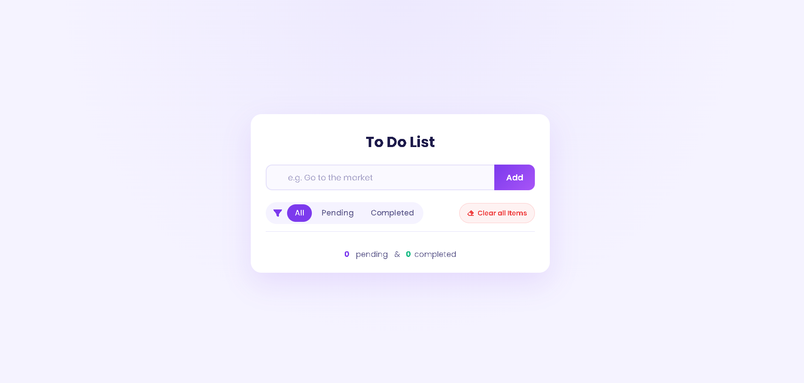
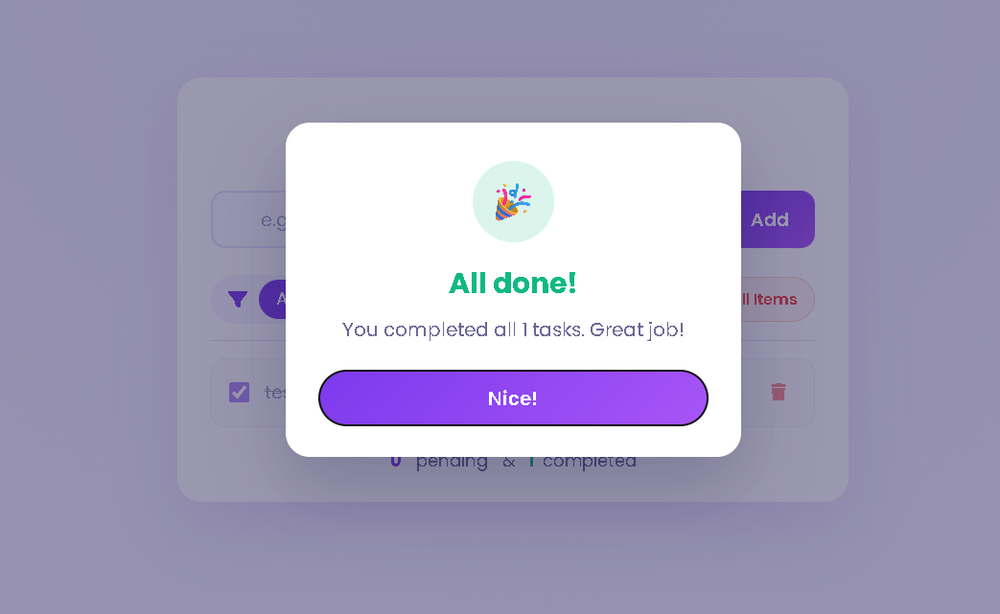

# To Do List

A task manager where you can add, edit, complete, and delete tasks. Tasks are saved in the browser's local storage, so they're still there after you refresh the page. You can filter tasks by status and see a live count of pending and completed tasks.

## Screenshots

### Main list


### All tasks completed



## Features

- Add tasks with the button or the Enter key
- Edit a task by clicking the edit icon
- Mark tasks as complete with the checkbox or by clicking the task
- Filter tasks by **All**, **Pending**, or **Completed**
- Live counter for pending and completed tasks
- Clear all tasks in one click
- Tasks saved in local storage, so they stay after a refresh
- Input is checked: empty values and HTML tags are rejected
- Popup when every task is completed

## How to Run

1. Clone the repository:
   ```bash
   git clone https://github.com/abdallaahemd/To-Do-List.git
   ```
2. Open the project folder.
3. Open `index.html` in your browser.

## Project Structure

```
To-Do-List/
├── index.html         # Page layout
├── styles.css         # Styles
├── app.js             # Task logic, filters, and popup
├── bars-icon.svg      # Icon shown in the input field
└── screenshots/       # Screenshots used in this README
```

## What I Learned

- Creating and removing elements with `createElement`, `appendChild`, and `remove()`
- Storing data as JSON with `localStorage`, using `JSON.stringify` and `JSON.parse`
- Filtering arrays with `filter()` and counting with `reduce()`
- Event delegation: one listener on the list handles clicks on every task
- Using the `Date.now()` value as a unique ID for each task
- Checking if a string contains HTML by creating an element from it

## Built With

- HTML
- CSS
- JavaScript
- Font Awesome

## Author

**Abdallah Ahmed**: Programming instructor and developer
- LinkedIn: https://www.linkedin.com/in/abdalla-konsowa-386414203
- itch.io: https://abdallak.itch.io/
